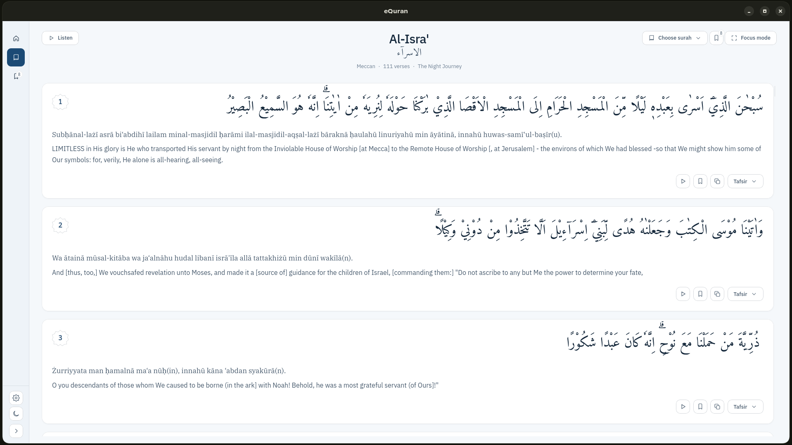
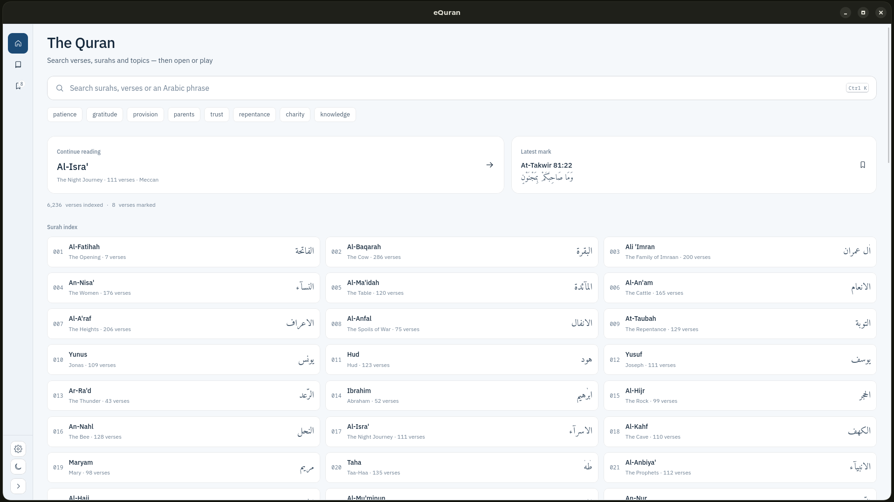
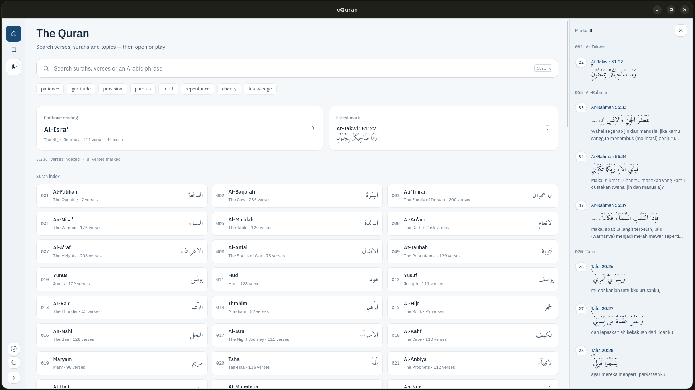

# eQuran

[](https://github.com/danisec/eQuran/actions/workflows/ci.yml)
[](https://github.com/danisec/eQuran/releases/latest)
[](LICENSE)
[](https://www.rust-lang.org)
[](https://tauri.app)

A desktop reader for the Qur'an that recites it. Read the mushaf, listen to any of
six qari, and hear the translation and tafsir spoken on-device — in Indonesian or
English — without sending your reading anywhere.

Also ships a command-line player for the same audio.



## Contents

- [Why this exists](#why-this-exists)
- [Requirements](#requirements)
- [Quick start](#quick-start)
- [Installation](#installation)
  - [Desktop packages](#desktop-packages)
  - [Build from source](#build-from-source)
- [Reciters](#reciters)
- [Usage](#usage)
  - [Desktop](#desktop)
  - [Command line](#command-line)
- [Translation voice](#translation-voice)
- [Cache and storage](#cache-and-storage)
- [Configuration](#configuration)
- [Data sources and attribution](#data-sources-and-attribution)
- [Troubleshooting](#troubleshooting)
- [Limitations](#limitations)
- [Tests](#tests)
- [Contributing](#contributing)
- [Licence](#licence)

## Why this exists

The Qur'an is read with the ear as much as the eye. Existing players either stream
one reciter with no translation, or bolt a cloud text-to-speech API onto the text,
which means a network round trip and a third party hearing what you read. This
project keeps the recitation and the narration on the machine: qari audio is cached
from the EQuran.id library, and the translation and tafsir are spoken locally by
[Supertonic 3](https://github.com/supertone-inc/supertonic).

The desktop app is a reader first. Search, marks, tafsir, focus mode and a
reading session are there because reading a surah, not queueing a file, is the
point.

## Requirements

| | |
|---|---|
| OS | Linux (RPM/DEB or source). The code targets Windows and macOS too; only Linux is packaged. |
| Rust | 1.88+ (edition 2024, uses let-chains) for a source build |
| Node | 22.18+ or 24 for the desktop frontend (Vite 8; the tests run `.ts` directly) |
| System | `alsa-lib-devel` / `libasound2-dev` and the [Tauri Linux prerequisites](https://v2.tauri.app/start/prerequisites/) for a source build |
| Python | 3.12–3.14, with `pip`, for the speech runtime (the app runs without it, qari only) |
| Disk | ~400 MB for the speech model, downloaded on first synthesis, plus the caches below |

Reading and recitation need nothing but the app. The speech runtime is optional
and only gates the translation and tafsir voice; when it is missing the app says
so and keeps playing the qari.

## Quick start

The fastest path to a working app is a package — see
[Desktop packages](#desktop-packages). To run from a checkout, prepare the speech
runtime once and start the app; Tauri builds and serves the frontend for you:

```bash
git clone https://github.com/danisec/eQuran.git
cd eQuran
bash tts/setup.sh                       # one-time speech runtime (~400 MB model, first synthesis)
cd frontend && npm ci && cd ..          # frontend dependencies
cd crates/equran-desktop
cargo tauri dev                         # runs from this directory, as Tauri expects
```

The command-line player is two more lines, from the repository root:

```bash
cd ../..                                # back to the repository root
cargo build --release --features audio
./target/release/equran-cli play --surah 1 --qari misyari --lang id
```

## Installation

### Desktop packages

The [latest release](https://github.com/danisec/eQuran/releases/latest) ships RPM
and DEB packages for x86_64. Pick the one for your distribution.

**RPM (Fedora, RHEL, openSUSE):**

```bash
sudo dnf install https://github.com/danisec/eQuran/releases/download/v1.1.0/eQuran-1.1.0-1.x86_64.rpm
```

**DEB (Debian, Ubuntu, Mint):**

```bash
wget https://github.com/danisec/eQuran/releases/download/v1.1.0/eQuran_1.1.0_amd64.deb
sudo apt install ./eQuran_1.1.0_amd64.deb
```

Launch **eQuran** from your application menu, or run `equran-desktop`.

Reading, search, marks and qari recitation work immediately. To turn on the
[translation voice](#translation-voice), open **Settings → Translation voice** and
press **Set up voice**: the app downloads the speech engine (~400 MB) into its own
data directory. No password and no separate package install are needed.

The same thing from a terminal, if you prefer:

```bash
VENV_DIR="$HOME/.local/share/id.equran.desktop/tts/.venv" bash /usr/lib/eQuran/tts/setup.sh
```

> [!NOTE]
> Older `voice-v1` packages carry the earlier Coqui TTS engine with a downloaded
> voice pack. They are superseded by the `v1.1.0` packages above, which ship the
> Supertonic 3 pipeline this README describes.

### Build from source

This is the path to the current app, including the Supertonic 3 voice. The
workspace has three crates: `equran-core` (library), `equran-desktop` (Tauri app)
and `equran-cli` (command line).

```bash
git clone https://github.com/danisec/eQuran.git
cd eQuran

# Command-line player
cargo build --release --features audio
sudo install -Dm755 target/release/equran-cli /usr/local/bin/equran-cli

# Desktop app
bash tts/setup.sh                       # one-time speech runtime
cd frontend && npm ci && cd ..
cd crates/equran-desktop
cargo tauri build                       # bundles deb, rpm and AppImage under target/release/bundle
```

## Reciters

Six reciters, keyed by the short name below (`--qari`, or the Reciter field in
Settings). Aliases are accepted: `mishary`/`afasy` for `misyari`, `ibrahim` for
`dossari`, `abdullah` for `juhany`.

| Reciter | Short name | Alias |
|---|---|---|
| Abdullah Al-Juhany | `juhany` | `abdullah` |
| Abdul Muhsin Al-Qasim | `qasim` | |
| Abdurrahman As-Sudais | `sudais` | |
| Ibrahim Al-Dossari | `dossari` | `ibrahim` |
| Misyari Rasyid Al-Afasy | `misyari` | `mishary`, `afasy` |
| Yasser Al-Dosari | `yasser` | `yasir` |

## Usage

### Desktop

Two surfaces, switched from the left rail (the app has no router; it is one
window with a small state machine).

**Home** — global search over Arabic, transliteration, translation and tafsir, plus
topics, continue-reading and your latest mark.



**Read** — the mushaf. Every verse carries its translation, a play button that
queues from that verse to the end of the surah, a bookmark, and its tafsir.
**Dengarkan** / **Listen** in the header plays the whole surah.

**Marks** — your own verses, grouped by surah, each readable on its own.



Keyboard: `Space` play/pause, `Cmd/Ctrl+←/→` previous/next verse,
`Cmd/Ctrl+K` focus search (on Home), `Cmd/Ctrl+M` marks, `Cmd/Ctrl+B` collapse
the rail, `Cmd/Ctrl+,` settings. `Esc` leaves focus mode.

Playback is one **session**, not one verse: the bar, the active verse and the
skip buttons follow the session, so browsing the mushaf while audio plays never
changes what is playing. A finished surah stays on screen with a replay button
until you close it or start a new session.

### Command line

```bash
equran-cli list                          # all 114 surahs
equran-cli info --surah 1                # surah metadata

# Play a whole surah, with the Indonesian translation after each verse
equran-cli play --surah 1 --qari misyari --lang id

# A single verse, or a range
equran-cli play --surah 1 --ayat 1 --qari dossari --lang id
equran-cli play --surah 2 --from-ayat 1 --to-ayat 5 --qari misyari --lang id

# Text only, no audio
equran-cli play --surah 1 --qari misyari --lang id --dry-run

# Prepare all audio before playback, or turn off background prefetch
equran-cli play --surah 1 --qari dossari --lang id --pregenerate-tts
equran-cli play --surah 1 --qari dossari --lang id --no-prefetch
```

`--help` covers every flag: `equran-cli --help`, `equran-cli play --help`.

## Translation voice

Translation and tafsir are spoken on-device by **Supertonic 3**, an ONNX
multilingual engine. Nothing is sent to a TTS service.

In the packaged app, open **Settings → Translation voice** and press **Set up
voice**. The app runs the bundled setup script for you, writing the runtime into
its own data directory (`~/.local/share/id.equran.desktop/tts/.venv`) so no
password is required. Progress is shown in the panel.

From a checkout, the equivalent is:

```bash
bash tts/setup.sh          # writes tts/.venv
```

The setup script picks the newest supported Python interpreter (3.12–3.14),
creates the venv and installs `supertonic`. The model (~400 MB) is downloaded on
first synthesis and cached under `~/.cache/supertonic3/`. For GPU acceleration run
`bash tts/setup-gpu.sh` instead; it detects CUDA, ROCm, DirectML or CoreML and
falls back to CPU.

There is **no fallback engine**. If the runtime is not ready, a Settings banner
names the real cause, offers the setup action, and lets you copy the equivalent
command; the app plays the qari alone rather than silently switching to another
voice. A long tafsir is spoken in chunks, so the first sentence starts as soon as
it is rendered instead of waiting for the whole verse.

## Cache and storage

```text
~/.cache/equran-cli/
├── audio/     # qari MP3 from EQuran.id
├── tts/       # synthesized narration (WAV)
└── index/     # local search index
```

Narration is uncompressed WAV at roughly 88 KB per second, and one ayah's tafsir
can be tens of megabytes, so the cache is kept inside a cap rather than left to
grow. At startup the app sweeps leftover `.part` files from interrupted renders,
then evicts the least recently used media until the total is under the cap. The
cap defaults to **2 GB**; set `EQURAN_TTS_CACHE_LIMIT_MB=0` to turn it off.

Settings → **Advanced** shows what the cache holds against the cap, broken down
by qari, translation and tafsir, with a **Clear cache** button. Both the startup
prune and Clear cache refuse to run while audio is playing, so a file is never
removed out from under the player. The search index has its own lifecycle and is
never touched by either.

## Configuration

All optional. Set them in the environment of the app process.

| Variable | Default | Effect |
|---|---|---|
| `EQURAN_TTS_CACHE_LIMIT_MB` | `2048` | Media cache cap in MB. `0` disables pruning. |
| `EQURAN_TTS_PYTHON` | auto | Python interpreter for the speech runtime. |
| `EQURAN_TTS_SUPERTONIC` | auto | Path to `tts_supertonic.py`. |
| `EQURAN_TTS_SUPERTONIC_VOICE` | `M2` | Voice id: `M1`–`M5`, `F1`–`F5`. |
| `EQURAN_TTS_DEVICE` | `auto` | `auto` or `gpu` uses a GPU when present; `cpu` forces CPU. |
| `EQURAN_TTS_THREADS` | `min(cpu/2, 8)` | Intra-op threads. |
| `EQURAN_TTS_ONNX_PROVIDERS` | auto | Explicit ONNX Runtime provider list. |
| `EQURAN_TTS_IDLE_TIMEOUT` | `600` | Seconds idle before the speech service exits and releases the model. `0` keeps it alive. |
| `EQURAN_TTS_SUPERTONIC_STEPS` | `5` | Diffusion steps. Higher is slower, the library default is `8`. |
| `UMMAH_API_KEY` | unset | Optional key for the English tafsir endpoint. Never stored in the repo. |

## Data sources and attribution

This project is a client. It does not own or author the text or the recitation.

| Content | Source | Licence/terms |
|---|---|---|
| Indonesian text, English text, qari audio, Indonesian tafsir | [EQuran.id](https://equran.id) API | EQuran.id's own terms |
| English tafsir (*Ma'arif al-Qur'an*) | [UmmahAPI](https://ummahapi.com/api/docs) | UmmahAPI's own terms |
| Speech synthesis | [Supertonic 3](https://github.com/supertone-inc/supertonic) by Supertone | Supertonic's own licence |

The search index, the playback engine, the desktop interface and the cache
management are original to this project. Endpoint URLs and field names are facts
about those services, used for interoperability.

## Troubleshooting

| Symptom | Cause | Fix |
|---|---|---|
| Translation voice never speaks; Settings shows a notice | Speech runtime missing | Press **Set up voice** in Settings, or run the command shown there |
| Notice names a Python or interpreter error | `python3` is newer than the ONNX wheels support | Let `setup.sh` pick 3.12–3.14, or set `EQURAN_TTS_PYTHON` |
| Narration is slow | No GPU build of ONNX Runtime | `bash tts/setup-gpu.sh`, or lower `EQURAN_TTS_SUPERTONIC_STEPS` |
| Qari audio does not play on a source build | Built without the audio feature | `cargo build --release --features audio` |
| Clear cache does nothing and says to stop playback | Audio session active | Stop playback, then clear |
| First synthesis stalls for a while | Model downloading (~400 MB) | One-time; wait for it to finish |

## Limitations

* **Read-only, and offline by design.** Nothing is uploaded: the index is built
  locally, narration is rendered locally, and only qari audio and text are
  fetched.
* **Narration is not a human recitation.** The translation and tafsir voice is a
  synthesized voice, separate from the qari.
* **Tafsir narration is long.** An English tafsir can run for many minutes per
  ayah; it is meant for careful listening, not background play.
* **No iOS/Android build.** The Tauri targets exist but only Linux is packaged.
* **Content depends on third parties.** EQuran.id and UmmahAPI can change or rate
  limit; a failure surfaces as a fetch error, not a broken screen.
* **The "Ask about this verse" assistant is deliberately not built.** The place is
  reserved on Home; see `DEVELOPER.md`.

## Tests

```bash
cargo test --workspace --all-features     # Rust: core, desktop, CLI
cargo fmt --all --check
cargo clippy --workspace --all-targets --all-features -- -D warnings

cd frontend
npm ci
npm run check                             # svelte-check
npm test                                  # frontend unit tests
```

## Contributing

Issues and pull requests are welcome. The short version:

* **Keep CI green** — `cargo fmt`, `clippy -D warnings`, the Rust tests and the
  frontend checks must pass.
* **A change needs a test.** A bug fix needs a test that fails without it.
* **Match the surrounding style** — comments explain *why*, not *what*.
* **No new runtime dependencies** without a reason in the PR.

Full guidance is in [CONTRIBUTING.md](CONTRIBUTING.md). Build and architecture
notes are in [DEVELOPER.md](DEVELOPER.md).

## Licence

MIT — see [`LICENSE`](LICENSE). The Qur'anic text, recitations and tafsir belong
to their sources, listed under [Data sources and attribution](#data-sources-and-attribution);
this licence covers the code, not that content.
